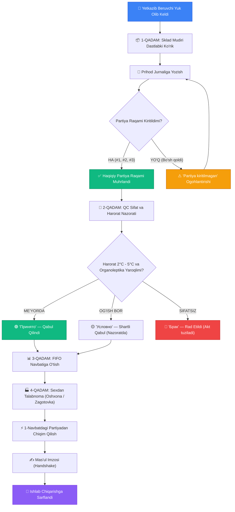
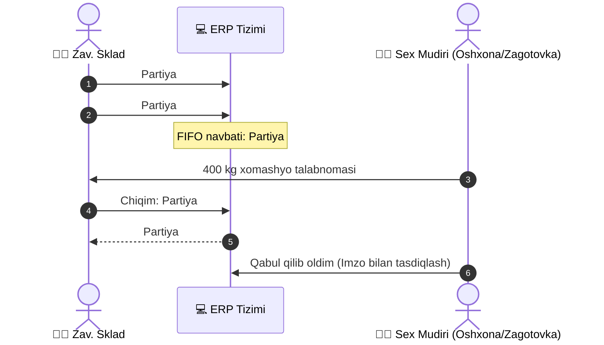

# GREEN PROCESSING — STANDART OPERATSION QO'LLANMA (SOP)
## Standard Operating Procedure: Xomashyo Qabuli, FIFO Partiya Nazorati va Sexga Chiqim

> [!NOTE]
> Ushbu hujjat **Green Processing** ishlab chiqarish korxonasining xomashyo ombori (Zav. sklad), Sifat nazorati (QC), Ishlab chiqarish sexlari (Oshxona, Zagotovka) va Boshqaruv xodimlari uchun yagona standart operatsion tartibni (SOP) belgilaydi.

---

## 1. Asosiy Maqsad va Tamoyillar

1. **FIFO (First In, First Out)**: Ombordagi xomashyolardan eng birinchi kelgan partiya birinchi bo'lib sexga beriladi.
2. **FEFO (First Expired, First Out)**: Yaroqlilik muddati tezroq tugaydigan tez buziluvchi sabzavotlar (salat, pomidor, ko'katlar) ustuvor sarflanadi.
3. **Aniq Partiya Nazorati**: Hech qanday sun'iy tizim kodlari (`#9341`, `BATCH-...`) ishlatilmaydi. Har bir yuk qabulida haqiqiy oylik tartib raqami (`#1`, `#2`, `#3`...) yoki yetkazib beruvchi partiyasi kiritiladi. Agar kiritilmagan bo'lsa, tizimda darhol **"Partiya kiritilmagan"** ogohlantirishi turadi.
4. **Mas'ullar Imzosi (Handshake)**: Kirim, chiqim va tayyor mahsulot jadvallarida har bir operatsiyani bajargan shaxsning shaxsiy imzosi muhrlanadi.

---

## 2. Vizual Jarayon Xaritasi (Process Flowchart)

---

## 3. Bosqichma-bosqich Amaliy Ko'rsatmalar

### 1-Bosqich: Xomashyo Qabul Qilish va Partiya Berish (Zav. Sklad)

> [!IMPORTANT]
> **Partiya raqamlash qoidasi**: Har bir tovar turi bo'yicha har oyning boshidan boshlab ketma-ket tartibda raqamlanadi:
> - Masalan: Noyabr oyining 1-kelgan pomidori — **Partiya #1**, 2-kelgani — **Partiya #2** va h.k.
> - Tizimdagi `⚡` tugmasini bossangiz, avtomatik oy boshidan hisoblangan to'g'ri navbatdagi partiyani qo'yib beradi.

1. Skladchi avtomashinadan kelgan xomashyoning brutto/netto vaznini tarozida o'lchaydi.
2. Tizimda **"Kirim (Prihod)"** bo'limiga kirib yangi qator qo'shadi:
   - Sana, Soat (masalan: 08:30)
   - Xomashyo nomi (Tomat, Salat Aysberg, Oq karam...)
   - Faktik qabul miqdori (kg yoki dona)
   - Qutilar / yashiklar soni
   - Ta'minotchi nomi va Nakladnoy raqami
   - **Partiya raqami** (`#1`, `#2` yoki etiketkadagi partiya)
3. Skladchi o'zining **Mas'ul Imzosi**ni tanlaydi va saqlaydi.

---

### 2-Bosqich: QC va Harorat Nazorati (Sifat Bo'limi)

1. Sifat mutaxassisi (QC) transport va mahsulotning o'zak haroratini o'lchaydi:
   - **Me'yor**: `+2°C dan +5°C gacha` (Sovuq zanjir talabi).
2. Organoleptik ko'rik (rangi, hidi, yangiligi, zararlanish yo'qligi) tekshiriladi.
3. Tizimda qaror tanlanadi:
   - `Принято (Qabul)` — ombor zaxirasiga to'liq o'tadi.
   - `Условно (Shartli)` — nazorat ostida, zudlik bilan ishlatish sharti bilan.
   - `Брак (Rad)` — qabul qilinmaydi, brak dalolatnomasi tuziladi.
4. QC mutaxassisi haroratni kiritadi va o'z imzosini qo'yadi.

---

### 3-Bosqich: Ombordagi Qoldiq va FIFO Navbati

1. Tizimning **"Ombor Holati"** jadvalida:
   - **Skladdagi Qoldiq**: Ayni damdagi haqiqiy jami qoldiq (ezilmaydi, keng formatda ko'rinadi).
   - **FIFO Navbatdagi Partiya**: Sexga birinchi berilishi kerak bo'lgan partiya.
     - Agar partiya raqami kiritilgan bo'lsa: **`Partiya #1`** (yashil nishon).
     - Agar kiritilmagan bo'lsa: **`Partiya kiritilmagan`** (sariq ogohlantirish nishoni).
   - **Muddati (FEFO)**: Tugashiga necha kun qolgani ko'rsatiladi.

---

### 4-Bosqich: Sexga Chiqim Qilish (Oshxona va Zagotovka)

> [!WARNING]
> Tizim avtomatik ravishda eng eski partiyani 1-o'rinda beradi. Eski partiya to'liq yopilmaguncha yangi partiyani ochish taqiqlanadi!
> Agar xomashyo sifatiga ko'ra yangi partiyani ochish zarur bo'lsa, faqat **QC ruxsati (Istisno)** bilan amalga oshiriladi.

1. Sexdan talabnoma kelganda, Skladchi **"Chiqim (Rashod)"** bo'limida tegishli partiyadan miqdorni chiqaradi.
2. Chiqim hujjati avtomatik tarzda Sex qabul jurnalida ko'rinadi.
3. Sex qabul qiluvchi oshpaz yoki usta miqdorni tarozi orqali tasdiqlaydi va o'z imzosini qo'yadi.

---

## 4. Mas'uliyat Jadvali (RACI Matritsasi)

| Jarayon Bosqichi | Zav. Sklad | QC Nazoratchi | Texnolog | Sex Ustasi | Boshqaruv |
| :--- | :---: | :---: | :---: | :---: | :---: |
| 1. Yuk tushirish va tortish | **R** (Bajaruvchi) | I (Xabardor) | - | - | - |
| 2. Prihodga partiya raqami berish | **A/R** (Javobgar) | C (Kuzatuvchi) | - | - | - |
| 3. Harorat va organoleptika | C (Yordamchi) | **A/R** (Javobgar) | C (Maslahatchi) | - | I |
| 4. Qabul / Rad qarori | I (Ijrochi) | **A/R** (Javobgar) | C (Ekspert) | - | I |
| 5. FIFO bo'yicha sexga tarqatish | **A/R** (Javobgar) | C (Nazorat) | - | R (Qabul qiluvchi) | - |
| 6. Ikki tomonlama imzo qo'yish | **R** | - | - | **R** | I |
| 7. Zaxira me'yori (Stock Level) | **A/R** | C | C | - | I |

*Belgilar: **A** (Accountable - Yakuniy javobgar), **R** (Responsible - Ijrochi), **C** (Consulted - Maslahat beruvchi), **I** (Informed - Xabardor qilinuvchi)*

---

## 5. Favqulodda Holatlar (Protocol & Deviations)

1. **Jadvalda "Partiya kiritilmagan" ko'rinsa**:
   - Sklad mudiri darhol "Kirim (Prihod)" jadvaliga kiradi.
   - Shu tovar qatoridagi "Partiya" katakchasiga haqiqiy partiya raqamini yozadi (yoki `⚡` tugmasini bosadi) va "Saqlash" tugmasini bosadi.
   - Shunda sariq ogohlantirish avtomatik yashil `Partiya #...` ga aylanadi.

2. **Harorat +5°C dan yuqori kelsa**:
   - Tizim qatorni qizil rang bilan belgilaydi.
   - QC zudlik bilan avtomashina refrijeratorini tekshiradi va reys haydovchisi bilan dalolatnoma tuzadi.

3. **17:00 dan keyingi o'zgartirishlar**:
   - Kunlik hisobot yopilgach kiritilgan har qanday tahrir tizimda audit jurnaliga muhrlanadi va tahrir sababi so'raladi.
